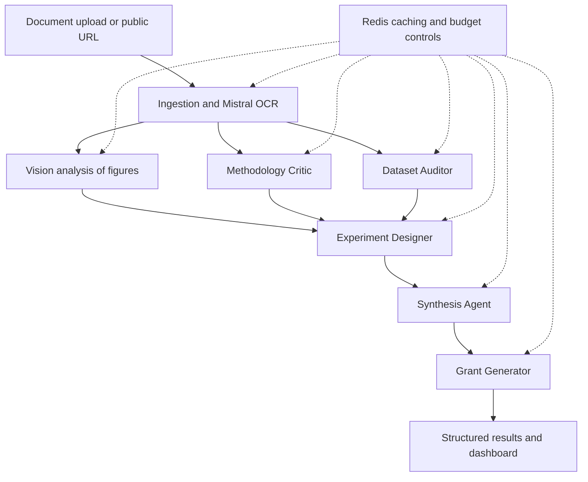

<p align="center">
  
</p>

<h1 align="center">Luminae</h1>
<p align="center"><strong>Multi-agent research analysis powered by Mistral AI</strong></p>
<p align="center">
  <a href="https://luminae.qzz.io/">Live application</a> ·
  <a href="https://luminae.qzz.io/dashboard">Analysis dashboard</a> ·
  <a href="https://youtu.be/ODygWunOA6Y">Video demonstration</a> ·
  <a href="https://rayklanderman.is-a.dev/">Developer portfolio</a>
</p>

<p align="center">
  
  
  
  
</p>

---

## Overview

**Luminae** is a research-analysis application that processes academic documents and coordinates specialized AI agents to critique methodology, audit dataset descriptions, propose follow-up experiments, synthesize findings, and draft structured grant outlines.

Built for the **Mistral Worldwide Hackathon**, it explores a practical engineering challenge: combining multimodal document understanding, structured LLM outputs, asynchronous orchestration, and cost controls in a usable full-stack application.

The goal is to **support a researcher's judgment**, not replace peer review or independent verification.

## What it does

| Capability | What Luminae produces |
| --- | --- |
| Document ingestion | Extracted content from uploaded files or supported public document URLs |
| Methodology review | Structured assessment of experimental design, confounders, power, and reproducibility |
| Dataset audit | Potential missing-data, sampling, representation, and bias concerns |
| Experiment design | Three proposed follow-up experiments with hypotheses, methods, feasibility considerations, and budgets |
| Research synthesis | Consolidated findings and follow-up questions across agent outputs |
| Grant drafting | A structured research proposal outline with aims, methods, and timeline |
| Usage visibility | API usage and cost information through the analysis dashboard |

**Supported uploads:** PDF, DOCX, PPTX, PNG, JPG, AVIF, and WebP. Public URLs to supported documents can also be provided. Extraction quality depends on the source document, and generated analyses require review.

## System architecture



Document processing is followed by parallel analysis stages, coordinated in the FastAPI backend with Python's `asyncio.gather`. Later agents build on earlier outputs so the final report is more than a single-pass summary. A separate vision-analysis step supplies figure context alongside extracted text.

### The five research agents

1. **Methodology Critic** — Reviews experimental design, potential confounding, statistical limitations, and reproducibility.
2. **Dataset Auditor** — Examines described data sources, sampling, missing data, representation, and possible bias.
3. **Experiment Designer** — Proposes three follow-up studies with testable hypotheses and implementation considerations.
4. **Synthesis Agent** — Combines findings across reviews and identifies questions or inconsistencies that merit attention.
5. **Grant Generator** — Converts selected research directions into a structured proposal outline.

The reasoning agents use Mistral's JSON output mode and application-side schemas to make results easier to validate, store, and render. Structured output improves integration reliability; it does **not** guarantee factual correctness.

### Mistral model roles

| Model | Role |
| --- | --- |
| `mistral-ocr-latest` | Document text, tables, and layout extraction |
| `ministral-3b-2512` | Interpretation of figures, charts, and diagrams |
| `ministral-8b-2512` | Structured analysis by the five research agents |

Model identifiers reflect the configuration described for this project and may need updating as provider availability changes.

## Technology stack

| Layer | Technologies |
| --- | --- |
| Frontend | Next.js, React, TypeScript, Tailwind CSS, shadcn/ui, TanStack Query, Zustand |
| API and orchestration | Python 3.11, FastAPI, Pydantic, HTTPX, `asyncio` |
| Models and document understanding | Mistral AI, Ministral, Mistral OCR |
| Database and authentication | Supabase, PostgreSQL, Row Level Security |
| Cache and budget state | Redis / Upstash |
| Repository tooling | Turborepo, pnpm |
| Deployment configuration | Vercel (web), Render (API) |

### Repository layout

```text
luminae/
├── apps/
│   ├── api/              # FastAPI backend and model orchestration
│   └── web/              # Next.js application and dashboard
├── packages/             # Shared application packages
├── infra/                # Infrastructure-related files
├── schema.sql            # Database schema and policies
├── .env.example          # Configuration template
├── render.yaml           # Render configuration
├── vercel.json           # Vercel configuration
├── turbo.json            # Monorepo tasks
└── deployment_and_costs.md
```

## Cost-aware engineering

The application was designed around a **$15 Mistral API budget** during hackathon development, making cost part of the architecture rather than an afterthought.

- **Preflight estimation:** Estimates request cost before calling the model; the documented default per-request cap is `$0.50`.
- **Budget circuit breaker:** Uses Redis-backed state to stop new calls when the configured budget approaches exhaustion; the documented threshold is `$2.00` remaining.
- **Caching:** Reuses eligible prior results to reduce repeated processing.
- **Usage logging:** Records usage for inspection in the dashboard and database.

The original project estimated approximately **$0.05 per paper** in an optimized scenario. This is an estimate, **not a guaranteed per-document price or a measured capacity of 300 papers**. Actual costs vary with document length, image content, model pricing, and retries; application-side limits should not be treated as a substitute for provider billing controls.

See [deployment and cost notes](deployment_and_costs.md) for more context.

## Run and deploy

**Prerequisites:** Node.js 18+, pnpm 8+, Python 3.11, and configured Mistral, Supabase, and Upstash credentials.

```bash
git clone https://github.com/RealDevRay/luminae.git
cd luminae
cp .env.example .env
pnpm install
pnpm dev
```

Configure the required environment variables before starting the services. The root `pnpm dev` command runs the Turborepo development tasks; Python backend dependencies may also need to be installed separately in `apps/api`.

For the API's documented deployment configuration:

```bash
cd apps/api
pip install -r requirements.txt
uvicorn src.main:app --host 0.0.0.0 --port 8000
```

### Configuration

Use the repository's [`.env.example`](.env.example) as the source of truth. Important settings include:

| Variable | Purpose |
| --- | --- |
| `LUMINAE_MISTRAL_API_KEY` | Mistral API authentication |
| `LUMINAE_SUPABASE_URL` | Backend Supabase project URL |
| `LUMINAE_SUPABASE_SERVICE_KEY` | Server-only Supabase service role key |
| `LUMINAE_UPSTASH_REDIS_REST_URL` | Redis REST endpoint |
| `LUMINAE_UPSTASH_REDIS_REST_TOKEN` | Redis authentication |
| `LUMINAE_MISTRAL_BUDGET_USD` | Application budget setting |
| `NEXT_PUBLIC_SUPABASE_URL` | Frontend Supabase URL |
| `NEXT_PUBLIC_SUPABASE_ANON_KEY` | Frontend Supabase anonymous/public key |
| `NEXT_PUBLIC_API_URL` | API endpoint used by the frontend |

Initialize the database schema using [`schema.sql`](schema.sql). The documented deployment setup uses **Render for the API** and **Vercel for the web application**; see the repository configuration and [deployment notes](deployment_and_costs.md).

**Security:** Never commit `.env`, API tokens, or database service-role keys. Keep privileged credentials on the server, review Row Level Security policies, and avoid uploading confidential research material without suitable permissions and data-handling controls.

## Engineering considerations

- **Grounding and verification:** OCR and model interpretations can omit, distort, or invent details; users should check outputs against original sources.
- **Research integrity:** Findings, experiment proposals, and grant drafts are decision-support artifacts, not validated scientific conclusions.
- **Cost and latency:** Multiple model calls make budget control, caching, and error handling important; processing time varies by input.
- **Structured outputs:** JSON mode and schema validation improve downstream parsing but do not eliminate model failure modes.

## Project links

**[Try Luminae](https://luminae.qzz.io/)** · **[Analysis dashboard](https://luminae.qzz.io/dashboard)** · **[Watch the demo](https://youtu.be/ODygWunOA6Y)**

Developed by **Raymond (DevRay) Klanderman** for the Mistral Worldwide Hackathon.

[Primary GitHub profile](https://github.com/rayklanderman) · [Project account: RealDevRay](https://github.com/RealDevRay) · [Portfolio](https://rayklanderman.is-a.dev/)
